# H0 Oikeasti netissä

## x. Lue ja tiivistä

[Niemi 2025: H4 Tehtävät](https://github.com/AONCODES/linux-course/blob/main/h4.md)

- Vuokrattiin serveri upcloudilta ja laitettiin se pystyy
- Otettiin ssh yhteys serveriin `ssh root@ip` 
- Lisättiin käyttäjä `adduser username sudo` 
- Lisättiin uudelle käyttäjä ssh avain jotta sillä voi kirjautua
- 
[Partanen 2025: Harjoitus 5: Nimekäs: a) Nimi](https://partanennn.github.io/linux-servers/practices/fifth-week.html)

- Ostettiin domain nimi namecheapilta
- Luotiin dns record domainille

## a. Paikallista

- Ensin latasin [Debian 13](https://www.debian.org/) 

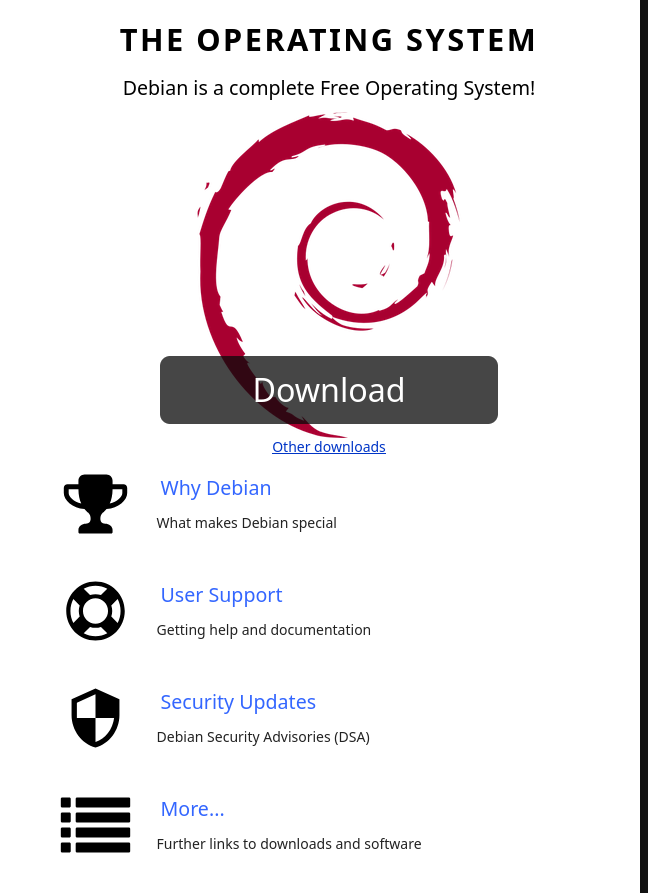

- Virtuaaliympäristönä käytän virtmanageria (Qemu/KVM) 
- Loin virtuaalikoneen ja säädin kaikki tarvittavat asetukset virtmanagerissa

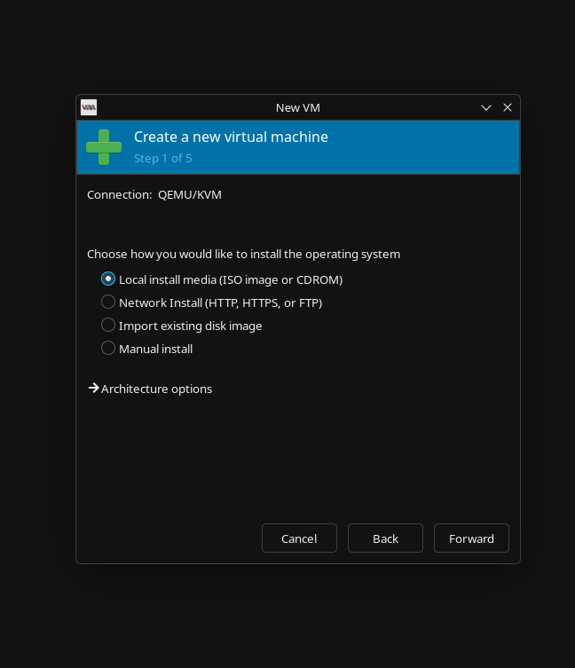

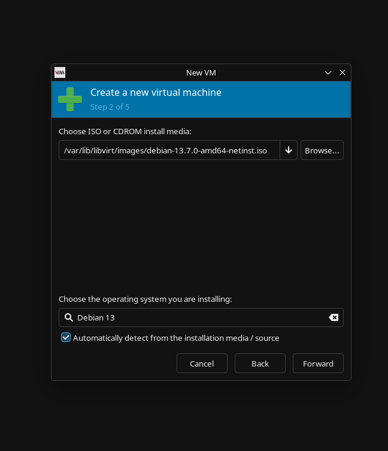

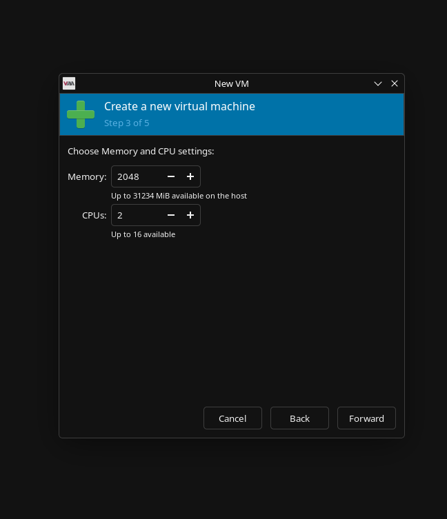

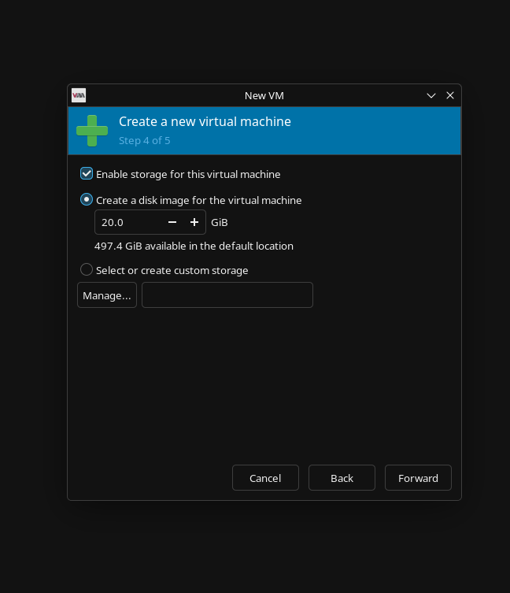

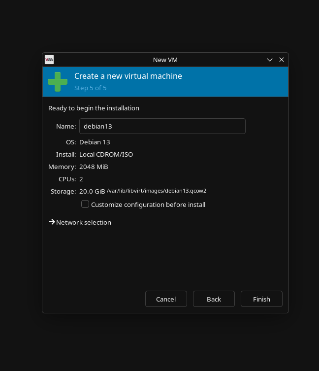

- Kun olin luonut koneen asensin itse Debianin

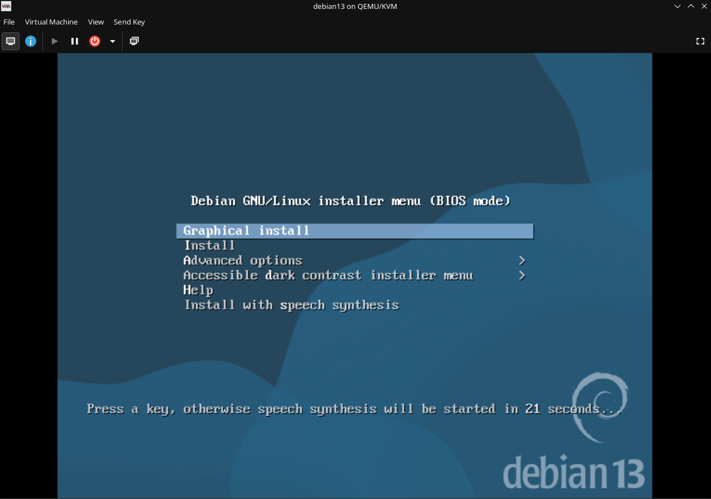

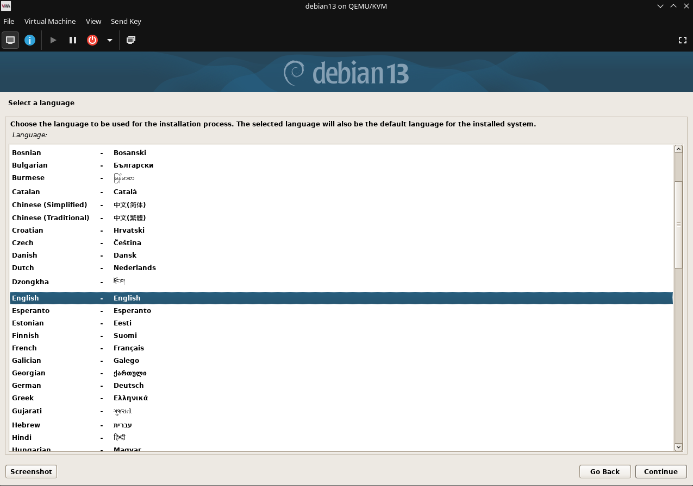

- Debian 13 asennettu

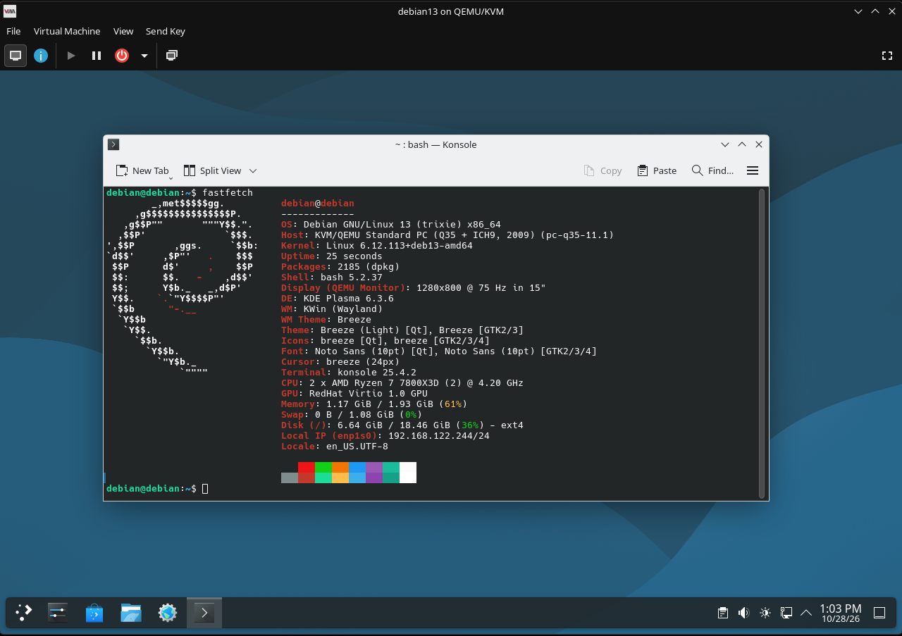

## b. VPS

- Vuokrasin serverin [Upcloudilta](https://upcloud.com/global/) 

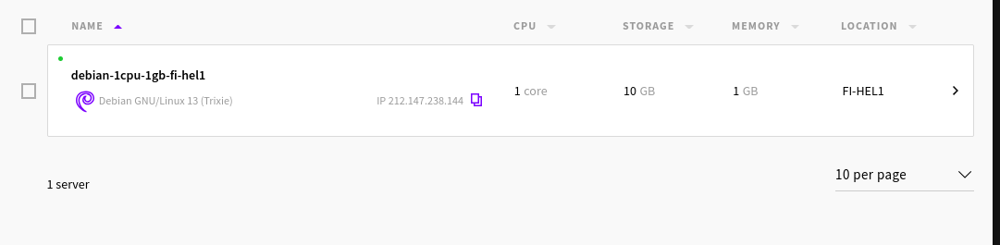

## c. Alkutoimet

- Otan ssh yhteyden koneelle komenollat 
	- `ssh -i .ssh/id_ed25519 root@94.237.119.72` 
	- Olin tätä ennen luonut ssh avain parin ja kopioinut julkisen avaimen upcloudiin
		- `ssh-keygen` 
	
- Lisään uuden käyttäjä komennolla 
	- `adduser username` 

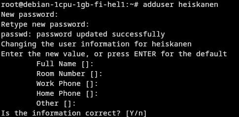

- Lisään uuden käyttäjän ryhmään sudo komenolla 
	- `usermod -aG sudo username` 
- Varmistan että uusi käyttäjä varmasti lisättiin sudo ryhmään komenolla 
	- `groups username` 

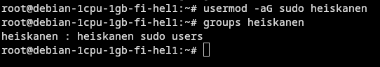

- Seuraavaksi päivitin järjestelmän komenolla 
	- `apt update && apt upgrade -y` 

- Tämän jälkeen asensin palomuurin valitisn [UFW](https://wiki.archlinux.org/title/Uncomplicated_Firewall) 
- Asensin sen komenolla
	- `apt install ufw` 
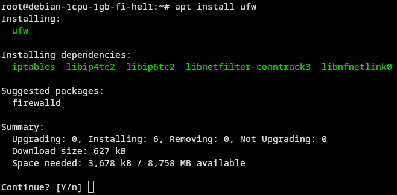

- Konfiguroin ufw:n sallimaan vain ssh yhteyden koneeseen komennoilla ja laitoin sen päälle

- `ufw allow shh`
- `uf default deny incoming`
- `ufw enable` 

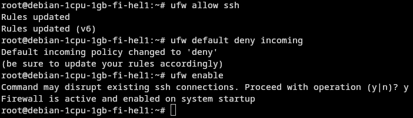

## d. Weppipalvelin

- Asensin koneelle [nginx](https://nginx.org/) komenolla 
	- `apt install nginx` 
	
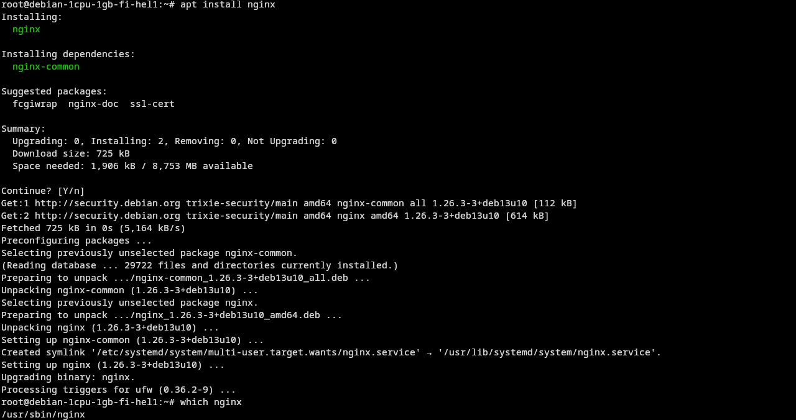