# h1 Hei Ansiblen maailma
## x. Lue ja tiivistä

[SSH public key - Login without password](https://terokarvinen.com/ssh-public-key-login-without-password/)

-  Asennetaan ssh `sudo apt-get -y install ssh`
-  Laitetaan ssh daemon päälle `sudo systemctl enable --now ssh`
-  Testataan ssh:ta `ssh localhost`
-  Luodaan ssh avainpari `ssh-keygen`
-  Kopiodaan julkinen avain laitteelle jotta voidaan kirjautua ilman salasanaa `ssh-copy-id localhost`

[Hello Ansible](https://terokarvinen.com/hello-ansible/)

- Luodaan hosts.ini tiedosto
- Kerrotaan miten ansiblea käytetään
	- `ansible all -a 'uptime' -i hosts.ini`
- Kerrotaan miten päästää **python virheestä eroon**
```
[all:vars]
ansible_python_interpreter=/usr/bin/python3
```
- Kerrotaan miten määritellään **hosts.ini** tiedosto inventory tiedostoksi
	- **ansible.cfg**
- **site.yml** määritys
- Oikeat kansiot ja tiedostot oikeisiin paikkoihin
- `ansible-playbook` komento
- Miten käytetään **sudoa** ansiblen kanssa
	- `become: true`
## a. [Paikallista](h0%20Oikeasti%20netissä.md#a.%20Paikallista)

## b. Sshecrets

- Ensin päivitin järjestelmän paketit
	- `sudo apt update`
	- `sudo apt upgrade`

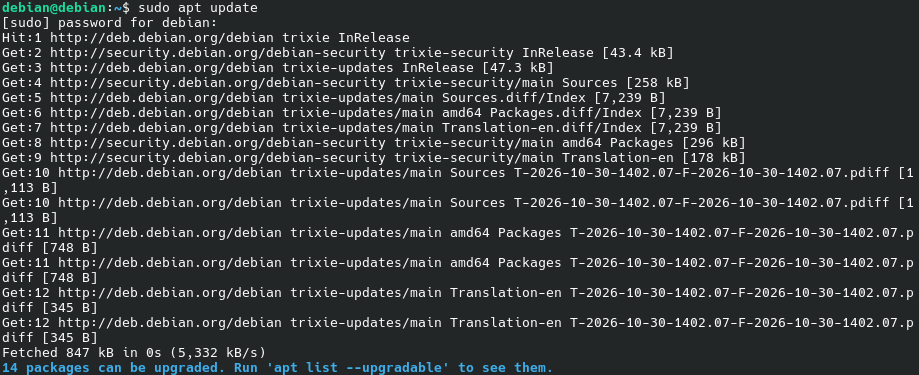

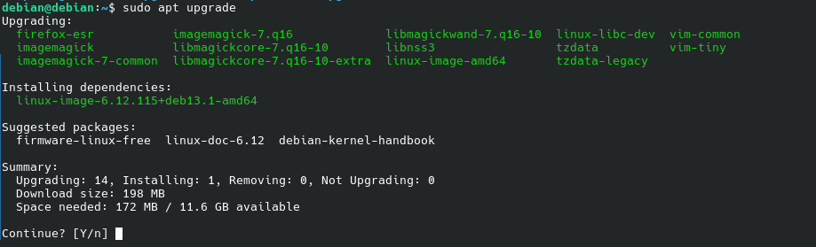

-  Sitten asensin ssh-demonin
	- `sudo apt install ssh`

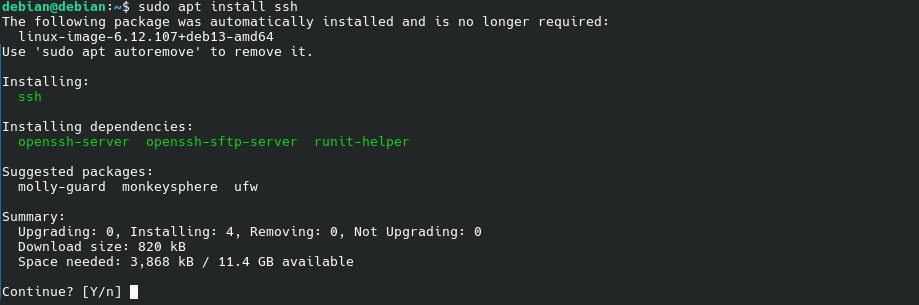

-  Asennuksen jälkeen laitoin sen päälle
	- `sudo systemctl enable --now ssh`
		-  Komento tekee niin että demoni on päällä järjestelmän käynnistyessä
		-  `--now` tekee niin että se menee myös päälle heti


- Testasin vielä kirjautumista
	- `ssh localhost`

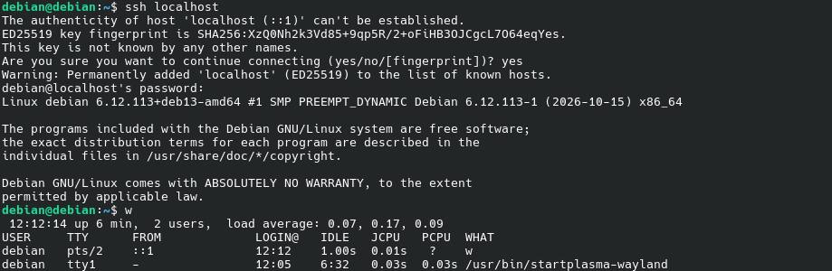
## c. Pubkey

- Loin ssh avainparin
	- `ssh-keygen`

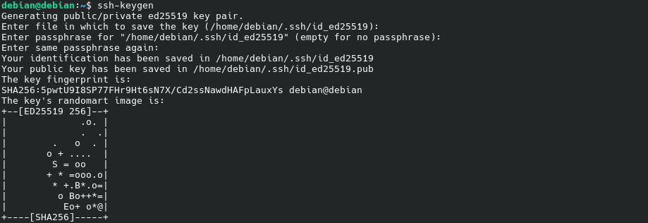

- Kopion juliksen avaimen serverille (localhost)
	- `ssh-copy-id localhost`

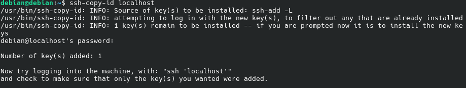

- Testasin vielä toimiiko kirjautuminen ilman salasanaa
	- `ssh localhost`

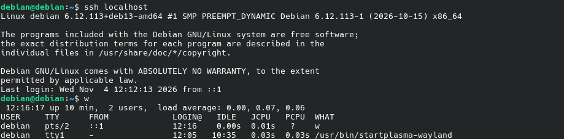
## d. Hei Ansible

- Ensin asensin ansiblen
	- `sudo apt install ansible`
- Sitten tein oman kansion missä voin tehdä ansible hommia
	- `mkdir ansible`
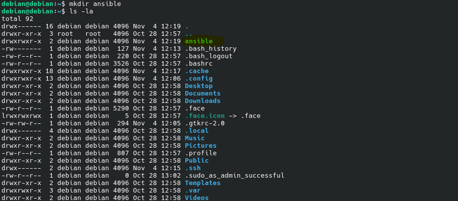

- Tein hosts tiedoston minne voin määritellä kaikki tietokoneet mitä haluan hallita ansiblella (tässä tapauksessa vain localhost)
	- `echo localhost >> hosts.ini`

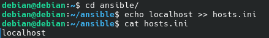

- Testasin toimiiko se
	- `ansible all -a 'uptime' -i hosts.ini`
		- `all` argumentilla määritellään missä tietokoneissa komento tehdään, eli tässä tapauksessa kaikilla
		-  `-a` argumentilla voidaan määritellä mikä komento kohde koneessa suoritetaan tässä tapauksessa `uptime`
		- `-i` määritellään inventory tiedosto
			- Jotta komennossa ei tarvitse jokakerta määritellä inventory tiedostoa voin määritellä sen suoraan *ansible.cfg* tiedostoon 
			- 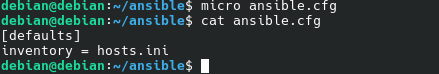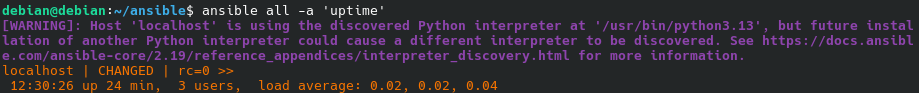


- Tein tarvittavat kansiot
	- `mkdir -p ./roles/hello/tasks`

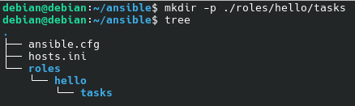

- Tein *main.yml* tiedoston *tasks* kansioon johon määritin tehtävän
	 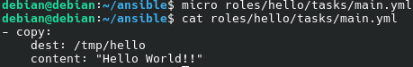

- Sitten tein *site.yml* tiedoston
		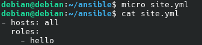

- Testasin toimiiko `ansible-playbook site.yml`
	- Jos toimii niin **tmp** kansiossa pitäisi olla **hello** niminen tiedosto jossa lukee **Hello World!!**

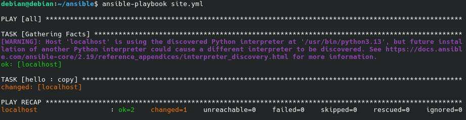
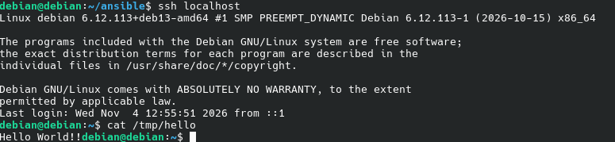

- Toimi!!

## e. Vapaaehtoinen bonus

- Halusin kopioda **hello** tiedoson **/etc** kansioon, mutta se vaatii sudo oikeudet
	- Lisäsin **site.yml** tiedostoon `become: true`, että voin tehdä komentoja **sudo** oikeuksilla
		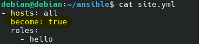

- Muutin **main.yml** tiedostosta kohde kansiota
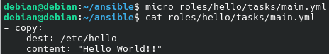

- Testasin toimiiko
	- `ansible-playbook site.yml --ask-become-pass`
		- `--ask-become-pass` kysyy sudo kohde koneen sudo salasanaa jotta komento voidaan toteuttaa
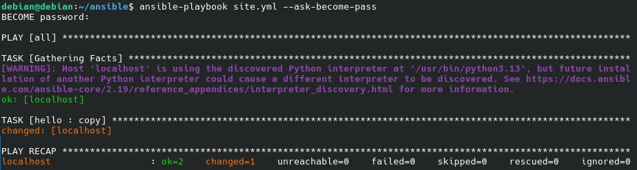
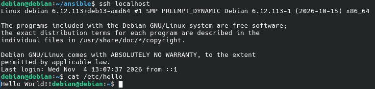

- Toimi!!!